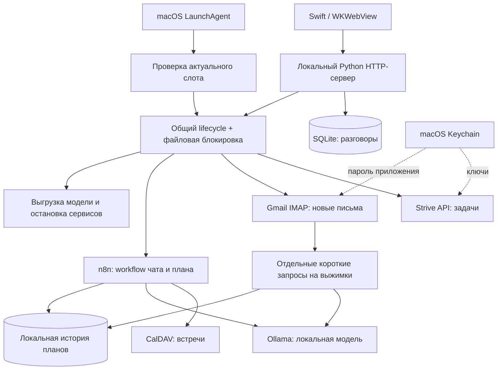

<div align="center">

# ✳ Ритм / Rhythm

### Personal planning. Local intelligence. Resources on demand.

Локальный AI-планировщик для macOS, который собирает календарь, задачи и новые письма в понятный план дня — и освобождает ресурсы после ответа.

**Swift · Python · JavaScript · n8n · Ollama · SQLite · macOS Keychain**

[Возможности](#возможности) · [Архитектура](#архитектура) · [Установка](#установка) · [Безопасность](docs/SECURITY.md) · [Разработка](CONTRIBUTING.md)

</div>

## Зачем нужен Ритм

Встречи живут в календаре, задачи — в таск-менеджере, новые обязательства приходят по почте. Ритм объединяет эти источники в одном интерфейсе и помогает понять, что делать сегодня и к чему подготовиться завтра.

Главное инженерное ограничение проекта — ноутбук не должен постоянно держать модель и инфраструктуру в памяти. Поэтому тяжёлые сервисы запускаются на время работы. История и готовые планы доступны через лёгкий локальный интерфейс.

Проект развивается как персональный pet project. Это работающий прототип для Mac с ручной настройкой собственных аккаунтов, а не сервис с регистрацией или универсальный установщик в один клик.

## Возможности

| Источник / компонент | Что делает |
| --- | --- |
| Календарь CalDAV | Читает встречи и передаёт их в контекст планирования; исходная установка использует Яндекс Календарь |
| Strive | Учитывает активные свои задачи и задачи без исполнителя из столбцов-дней: `6`, `9–10` и подобных |
| Gmail | Показывает новые письма из «Входящих» после предыдущего отчёта и краткую локальную выжимку каждого письма |
| Чат | Принимает свободные запросы, сохраняет локальную историю, отображает Markdown |
| Планы | Хранит утренние и вечерние отчёты отдельно от разговоров |
| macOS-приложение | Нативная оболочка Swift + WKWebView; запуск из Dock или Apple «Команд» |
| Управление ресурсами | Запускает Ollama и n8n для работы и останавливает их после завершения, учитывая другие запущенные задачи |

Подключения работают только для чтения. Ритм не отправляет письма, не создаёт события и не меняет задачи. Gmail читается без установки отметки «прочитано».

## Как проходит день

- **07:00, Москва:** план на текущий день.
- **23:00, Москва:** подготовка к следующему дню.
- **После сна:** готовится последний актуальный пропущенный план; очередь старых планов не воспроизводится.
- **По запросу:** приложение запускает помощника, формирует ответ и освобождает ресурсы.

Mac не пробуждается ради отчёта. После перезагрузки необходим вход пользователя. Лёгкая проверка расписания запускается каждые пять минут и сразу завершается, если работа не нужна.

## Архитектура



**n8n** отвечает за контекст календаря и генерацию плана. **Python** управляет жизненным циклом сервисов, интеграциями, периодами чтения почты и локальным хранением. **Swift** даёт привычную оболочку macOS и доступ к Связке ключей. Интерфейс написан на HTML/CSS/JavaScript без сборщика.

Письма суммируются отдельными запросами к той же локальной модели. Их полный текст не добавляется к общему контексту календаря и задач: это снижает риск переполнения ограниченного контекста. Готовый почтовый раздел присоединяется к отчёту программно.

Подробности: [архитектура и устойчивость](docs/ARCHITECTURE.md).

## Установка

### Требования

- macOS 13+; исходная установка проверена на Apple Silicon с 16 GB памяти.
- Python 3.10+ и Xcode Command Line Tools (`xcode-select --install`).
- Docker Desktop и Ollama с доступными командами `docker` и `ollama`.
- Отдельно установленная локальная модель. Исходная конфигурация использует `gemma4:e4b`; веса не включены в репозиторий.
- Собственный CalDAV-календарь. Strive и Gmail подключаются по желанию.

Docker-образ n8n закреплён на версии `2.46.6`; community node CalDAV — `n8n-nodes-caldav-pro` версии `3.5.2`. Совместимость других версий требует отдельной проверки.

### 1. Подготовить приложение

```sh
git clone https://github.com/x7inferno7x/rhythm.git
cd rhythm
python3 setup.py --check
python3 setup.py
```

Установщик создаёт `~/personal-ai-planner` и `~/Applications/Ритм.app`, собирает Swift-оболочку и помощники Keychain, генерирует новые идентификаторы workflow и webhook. Существующая установка не перезаписывается. Веса модели и аккаунты автоматически не устанавливаются. Расписание пока выключено.

### 2. Настроить n8n и календарь

Все следующие команды выполняются из `~/personal-ai-planner`:

```sh
cd ~/personal-ai-planner
python3 manage.py start
```

1. Откройте `http://127.0.0.1:5678`, создайте собственную учётную запись n8n.
2. В Settings → Community Nodes установите `n8n-nodes-caldav-pro@3.5.2`.
3. Выполните `python3 manage.py import`.
4. В обоих импортированных workflow назначьте свои credentials: Ollama с Base URL `http://host.docker.internal:11434` и CalDAV с собственными адресом, логином и паролем приложения.
5. В узле **Get many events** выберите свой календарь или настройте Default Calendar в CalDAV credential. В шаблоне оставлен `__DEFAULT__`.
6. Проверьте чтение календаря, сохраните workflow и выполните:

```sh
python3 manage.py publish
python3 manage.py stop
```

`manage.py start` специально оставляет сервисы включёнными для настройки. После настройки их нужно остановить.

### 3. Подключить свои источники

Откройте `~/Applications/Ритм.app` → **Подключения**.

**Strive:** создайте собственный API-токен, вставьте его в форму и нажмите «Сохранить и проверить». Доступность API зависит от аккаунта Strive. Числовые столбцы считаются датами текущего месяца по Москве; произвольные названия столбцов исключаются.

**Gmail:** создайте пароль приложения в настройках Google, укажите адрес и этот пароль в форме Gmail. Для паролей приложений обычно требуется двухэтапная аутентификация; доступность зависит от политики аккаунта. Основной пароль Google использовать не нужно. Первый период чтения начинается после последнего успешного сохранённого плана; при пустой истории — за последние 24 часа.

Ключ Strive и пароль Gmail сохраняются в Связке ключей macOS. Пароль CalDAV хранится в credentials собственного n8n. Репозиторий не содержит настроенных аккаунтов.

### 4. Включить расписание

После проверки чата и источников:

```sh
python3 manage.py schedule-on
```

Отключить:

```sh
python3 manage.py schedule-off
```

Добавьте приложение в Dock или Apple «Команды» действием «Открыть приложение». Адрес `http://127.0.0.1:8787` доступен, пока работает интерфейс; сам переход по ссылке сервер не запускает.

## Работа с ресурсами

При открытии приложения запускается только интерфейс. Для запроса используются общая блокировка и lifecycle-контекст: запуск → сбор данных → генерация → сохранение → очистка.

Модель выгружается после завершения. n8n останавливается, Docker Desktop завершается, если им не пользуются другие контейнеры. Чужая загруженная модель и активные выполнения n8n учитываются при очистке. При закрытии окна приложение дожидается текущей работы.

Во время генерации модель всё равно занимает значительный объём памяти и нагружает вычислительные ресурсы. В исходной проверке модель занимала около 9,5 GB; точная экономия батареи не измерялась. Холодный запуск может занимать несколько минут.

## Приватность и границы доверия

- Модель работает локально; внешние API нужны для чтения источников.
- История, планы, задачи и почтовые выжимки появляются только в приватной папке `runtime/` после установки.
- `runtime/`, диагностические экспорты, логи, базы, ключи и веса исключены из Git.
- Web-интерфейс и n8n привязаны к loopback; запись в UI требует проверки Host/Origin и локального заголовка.
- Markdown проходит очистку DOMPurify. Из писем не загружаются удалённые картинки.
- Письма, задачи и события — недоверенные данные; их инструкции не должны управлять системой.
- Во время работы Ollama слушает `0.0.0.0:11434`, чтобы контейнер n8n мог обратиться к ней. API модели не имеет пароля: сетевой доступ нужно ограничивать средствами macOS/firewall. Это локальный однопользовательский проект, не сервер для публикации в интернете.

Подробности и границы защиты: [SECURITY.md](docs/SECURITY.md).

## Структура репозитория

```text
native/          Swift-приложение, иконка и помощники Keychain
ui/              Локальный HTTP-сервер и интерфейс чата
workflows/       Два очищенных шаблона n8n
power.py         Жизненный цикл Ollama / Docker / n8n
wake-planner.py  Расписание, повторные попытки и запуск после сна
strive.py        Чтение и отбор задач Strive
mail_digest.py   Чтение Gmail, выжимки и контрольная точка отчёта
setup.py         Подготовка независимой установки
manage.py        Настройка workflow и расписания
tests/           Проверки логики без личных аккаунтов
```

## Проверки

```sh
python3 -m unittest discover -s tests -v
```

26 тестов проверяют границы расписания, очистку при ошибках, сохранение чужих сервисов, отбор задач Strive, чтение IMAP без изменения флагов и сохранение периода при сбое выжимки. CI проверяет Python-код и эти тесты без запуска модели и без доступа к аккаунтам.

На исходном Mac проверены приложение, календарь, Strive, чтение Gmail, локальные выжимки и остановка сервисов. Полная установка на чистом втором Mac ещё не проверялась.

## Ограничения и следующие шаги

- Calendar workflow пока требует настроенного CalDAV: его ошибка останавливает генерацию плана.
- Gmail читает только «Входящие», до 40 писем за один отчёт; остальные переходят в следующий. Тело ограничено 64 KiB; неполные письма помечаются. Вложения не анализируются.
- Ошибки выжимки не сдвигают период соответствующей почты, поэтому часть писем может повториться в следующем отчёте.
- Даты столбцов Strive относятся только к текущему месяцу; переход месяца не угадывается.
- Поддержка macOS и Docker Desktop ориентирована на исходную среду, не на все ОС.
- Telegram, Яндекс Почта и действия записи в источники не реализованы.
- Следующие задачи: установка на чистом Mac, настройка модели из интерфейса, деградация без календаря, более удобная диагностика источников и измерение энергопотребления.

Сторонние компоненты и их лицензии: [THIRD_PARTY.md](THIRD_PARTY.md).
